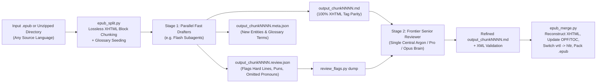

# Translate with Main Editor (`translator-with-main-editor`)

**An AI Agent Skill for lossless, XHTML-preserving EPUB book translation across any language pair using a Two-Stage Pipeline: Fast Parallel Translators (`Flash`) + a Frontier Main Editor (`Argon` / `Pro` / `Opus`).**

> Inspired by and built upon the foundational manifest, glossary, and state-tracking modules of **[`deusyu/translate-book`](https://github.com/deusyu/translate-book)**. While `translate-book` converts books into flat Markdown via Calibre and Pandoc and translates in a single subagent pass, this project replaces the conversion layer with **zero-dependency, native in-place EPUB XHTML splitting & reconstruction** (preserving 100% of publisher CSS, illustrations, SVG covers, bouten emphasis, and layout without Calibre or Pandoc) and introduces a **Two-Stage Translator + Main Editor (`.review.json`) architecture** for full-book organic editorial review.

[](./LICENSE)
[](https://www.python.org/)
[](https://www.w3.org/publishing/epub3/)

---

## Why This Workflow Exists

Traditional single-pass AI book translators run into a fundamental dilemma:
1. **Using a Frontier Reasoning Model (e.g., Gemini Argon / Pro, Claude Opus) on every line** produces gorgeous prose, but is **4–5x slower**, burns massive token quota on 12,000+ lines of straightforward XHTML tags, and still suffers from **cross-chunk inconsistency** when 50 parallel agents translate isolated chunks without seeing the whole book.
2. **Using a Fast Model (e.g., Gemini Flash) alone** is blazing fast and preserves HTML tags reliably, but can stumble on the hardest **5–10% of literary passages**: omitted Japanese/Chinese subjects, double-translation pronoun bugs, wordplay, unattributed rapid-fire dialogue, and subtle lore mechanics.

### The Solution: Two-Stage Speculative Localization
Just like a professional publishing house (where translators draft the manuscript and a Main Editor resolves tough nuances and unifies the book), `translator-with-main-editor` splits the work into two specialized stages:



- **Stage 1 — Parallel Fast Drafters (`Flash`)**: Translate 5–10 chunks in parallel with strict 1-to-1 XHTML tag preservation, glossary enforcement, and `±300`-char neighbor context. Crucially, whenever a Drafter encounters an ambiguous pronoun, omitted subject, pun, idiom, sudden POV shift, or source typo, it flags the exact line number, source text, draft translation, and explanation in `output_chunkNNNN.review.json`.
- **Stage 2 — Frontier Senior Reviewer (`Argon` / `Pro` / `Opus`)**: A single central Frontier agent dumps all flagged passages across the entire volume (`review_flags.py dump`), inspects them with full cross-book context, edits `output_chunkNNNN.md` wherever deep reasoning improves accuracy or voice, unifies terminology across chapters, and validates 100% XML well-formedness before packaging the `.epub`.

---

## Key Features

- **Works on Every Language Pair**: Supports any Unicode script—Japanese (`ja`), Chinese (`zh`), Korean (`ko`), English (`en`), Indonesian (`id`), Spanish (`es`), French (`fr`), German (`de`), Russian (`ru`), Portuguese (`pt`), etc.
- **100% Lossless XHTML & Layout Preservation**:
  - Never flattens your EPUB into plain text or lossy Markdown.
  - Preserves every `<p>`, `<span>`, `<ruby>`, `<svg>`, `<image>`, ``, CSS class, bouten emphasis (`em-sesame`), tate-chu-yoko (`tcy`), and internal TOC anchor (`id="toc-..."`).
  - Automatically converts vertical right-to-left (`class="vrtl"`, `page-progression-direction="rtl"`) Japanese/Chinese EPUBs into horizontal left-to-right (`class="hltr"`, `ltr`) for horizontal target languages (or keeps vertical layout with `--keep-vertical`).
- **Selective Rework & Pure-Frontier Locking**:
  - Want the climax chapters translated 100% by your Frontier model and the rest handled via Flash + Frontier Review? `run_state.py` and `review_flags.py --chunks` let you lock specific chunks so they are never overwritten while reworking or reviewing only the chunks you choose.
- **Built-in XML & Typography Sanitizer**:
  - Automatically validates every chunk with `xml.etree.ElementTree` before touching your EPUB files, converts stray Markdown `*italics*` into proper `<em>...</em>` XHTML tags, escapes bare `&` ampersands, and injects responsive illustration CSS (`img.fit`) so full-page illustrations never overflow e-reader screens.

---

## Benchmark: Hybrid vs. 100% Pure Frontier vs. 100% Fast Model

Evaluated on multi-volume Light Novel EPUB translations (~93 chunks / ~350,000 characters):

| Metric | 100% Fast Model (Flash Only) | 100% Frontier (Pure Argon) | **Hybrid (Flash + Argon Reviewer)** |
| :--- | :---: | :---: | :---: |
| **Hard Lines, Puns & Omitted Subjects** | 7.8 / 10 | 9.6 / 10 | **9.7 / 10** *(2-pass scrutiny catches source bugs)* |
| **Cross-Volume Glossary & Tag Consistency** | 8.5 / 10 | 9.2 / 10 | **9.8 / 10** *(Single central Reviewer unifies book)* |
| **Everyday Transitional Narration** | 9.1 / 10 | **9.7 / 10** | 9.2 / 10 |
| **Emotional Climaxes & Key Scenes** | 8.4 / 10 | **9.8 / 10** | **9.8 / 10** |
| **Speed & Quota Efficiency** | **9.8 / 10** | 5.0 / 10 | **9.5 / 10** *(~4x faster, ~75% less frontier quota)* |
| **Overall Reading Quality** | 8.5 / 10 | **9.6 / 10** | **9.5 / 10** |

---

## Installation

Clone this repository and copy the `skills/translator-with-main-editor` directory into your agent's skills folder:

```bash
git clone https://github.com/Brocc23/Translate-with-main-editor.git

# For Google Antigravity / Claude Code / Cursor / Codex workspace skills:
cp -r Translate-with-main-editor/skills/translator-with-main-editor /path/to/your/workspace/.agent/skills/
```

**Requirements**: Python 3.9+ (uses only the Python standard library—no external `pip` packages required!).

---

## Quick Start (CLI & Agent Workflow)

### 1. Split an `.epub` (or unzipped EPUB directory) into chunks
```bash
python skills/translator-with-main-editor/scripts/epub_split.py "MyBook.epub" \
  --temp-dir "work/mybook_temp" \
  --source-lang "zh" \
  --target-lang "en"
```

### 2. Prepare batch context for Stage-1 Fast Drafter subagents
```bash
python skills/translator-with-main-editor/scripts/prep_batch.py "work/mybook_temp" chunk0001 chunk0002 chunk0003 chunk0004
```

### 3. Dump all `.review.json` difficulty flags for the Stage-2 Main Editor
After the Fast Drafter subagents write `output_chunkNNNN.md` and `output_chunkNNNN.review.json`:
```bash
python skills/translator-with-main-editor/scripts/review_flags.py dump "work/mybook_temp" \
  --out "work/mybook_temp/all_flags.txt"
```

### 4. Validate XML well-formedness & clean up typography
After the Frontier Main Editor refines the flagged lines in `output_chunkNNNN.md`:
```bash
python skills/translator-with-main-editor/scripts/review_flags.py validate "work/mybook_temp" --fix-markdown-italics
python skills/translator-with-main-editor/scripts/run_state.py record-all "work/mybook_temp"
```

### 5. Merge back into XHTML and package the translated `.epub`
```bash
python skills/translator-with-main-editor/scripts/epub_merge.py \
  --temp-dir "work/mybook_temp" \
  --target-lang "en" \
  --title "My Book Title (Translated)" \
  --out-epub "My Book Title (Translated).epub"
```

---

## Repository Structure

```text
translator-with-main-editor/
├── README.md
├── LICENSE
└── skills/
    └── translator-with-main-editor/
        ├── SKILL.md                              # Complete instructions & prompt templates for AI agents
        ├── resources/
        │   ├── glossary_template.json            # Empty v2 glossary seed template
        │   └── toc_translations_example.json     # Example TOC title mapping
        └── scripts/
            ├── epub_split.py                     # Lossless XHTML block splitter (.epub or directory)
            ├── epub_merge.py                     # XHTML reconstructor, OPF/TOC updater & .epub packager
            ├── review_flags.py                   # Difficulty flag aggregator & XML/italic validator
            ├── prep_batch.py                     # Batch glossary + neighbor context generator
            ├── glossary.py                       # Term frequency & per-chunk glossary selector
            ├── chunk_context.py                  # Read-only ±300-char neighbor excerpt extractor
            ├── manifest.py                       # SHA-256 chunk manifest & merge verifier
            ├── meta.py                           # Subagent .meta.json schema validator
            ├── merge_meta.py                     # Glossary evolution & conflict resolver
            └── run_state.py                      # Incremental translation state tracker
```

---

## Credits & Acknowledgments

- **Original Book Translation Pipeline**: Special thanks and credit to **[`deusyu/translate-book`](https://github.com/deusyu/translate-book)** by [@deusyu](https://github.com/deusyu), which provided the foundational chunk-manifest, v2 glossary management, neighbor-context extraction, `.meta.json` merging, and `run_state.py` incremental tracking scripts (`manifest.py`, `glossary.py`, `chunk_context.py`, `meta.py`, `merge_meta.py`, `run_state.py`).
- **EPUB XHTML Preservation & Two-Stage Hybrid Drafter + Senior Reviewer Workflow**: Designed and developed to enable lossless in-place EPUB localization (`epub_split.py`, `epub_merge.py`, `prep_batch.py`, `review_flags.py`) and speculative difficulty routing (`.review.json`) between fast subagents (`Flash`) and frontier reviewer models (`Argon` / `Pro` / `Opus`).

---

## License

Released under the [MIT License](./LICENSE).
