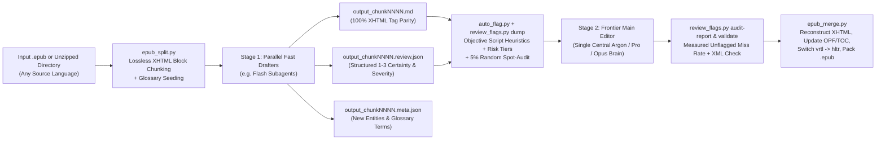

# Translate with Main Editor (`translator-with-main-editor`)

**An AI Agent Skill for lossless, XHTML-preserving EPUB book translation across any language pair using a Two-Stage Pipeline: Fast Parallel Translators (`Flash`) + Deterministic Script Heuristics (`auto_flag.py`) + a Frontier Main Editor (`Argon` / `Pro` / `Opus`).**

> Inspired by and built upon the foundational manifest, glossary, and state-tracking modules of **[`deusyu/translate-book`](https://github.com/deusyu/translate-book)**. While `translate-book` converts books into flat Markdown via Calibre and Pandoc and translates in a single subagent pass, this project replaces the conversion layer with **zero-dependency, native in-place EPUB XHTML splitting & reconstruction** (preserving 100% of publisher CSS, illustrations, SVG covers, bouten emphasis, and layout without Calibre or Pandoc) and introduces a **Two-Stage Translator + Main Editor architecture** powered by both **structured certainty scoring (`.review.json`)** and **deterministic script-side heuristics (`auto_flag.py`)** with a **5% random spot-audit (`audit-report`)**.

[](./LICENSE)
[](https://www.python.org/)
[](https://www.w3.org/publishing/epub3/)

---

## Why This Workflow Exists

Traditional single-pass AI book translators run into two fundamental dilemmas:
1. **Using a Frontier Reasoning Model (e.g., Gemini Argon / Pro, Claude Opus) on every line** produces gorgeous prose, but is **4–5x slower**, burns massive token quota on 12,000+ lines of straightforward XHTML tags, and still suffers from **cross-chunk inconsistency** when 50 parallel agents translate isolated chunks without seeing the whole book.
2. **Using a Fast Model (e.g., Gemini Flash) alone—or relying only on the fast model "feeling confused"** is blazing fast, but fast models are often **most confident when they are wrong** (e.g., silently picking `"he"` instead of `"I"` or `"she"` on an omitted Japanese/Chinese subject without realizing it's ambiguous).

### The Solution: Two-Stage Speculative Localization + Objective Heuristic Triggers
Just like a professional publishing house (where translators draft the manuscript, automated QA checks catch terminology/structural slips, and a Main Editor resolves tough nuances and unifies the book), `translator-with-main-editor` splits the work into two specialized stages backed by objective verification:



- **Stage 1 — Parallel Fast Drafters (`Flash`) with Structured Certainty Scoring**: Translate 5–10 chunks in parallel with strict 1-to-1 XHTML tag preservation, glossary enforcement, and `±300`-char neighbor context. Drafters score every non-trivial line from `1` to `3` (`1` = guessing/ambiguous, `2` = context-dependent, `3` = 100% certain) and must flag every line rated $\le 2$ with `"severity": "high" | "medium" | "low"` in `output_chunkNNNN.review.json`.
- **Deterministic Script-Side Heuristics (`auto_flag.py`)**: Because fast models don't know what they don't know, `auto_flag.py` scans every source and output line at **zero token cost** for objective risk signals:
  1. **Untranslated source-script residue** (`HIGH`): CJK/Kana/Hangul/Cyrillic/Arabic characters left in the target text.
  2. **Glossary violations** (`HIGH`): A glossary `source` term appears on line $L$ of `chunkNNNN.md`, but its canonical `target` is missing on line $L$ of `output_chunkNNNN.md`.
  3. **Length-ratio outliers** (`HIGH` / `MEDIUM`): Source-to-output length far below (`< 0.35x`) or above (`> 2.8x`) the chunk's median ratio, catching dropped clauses or hallucinated padding.
  4. **Unattributed consecutive dialogue streaks** (`MEDIUM`): Runs of $\ge 4$ quote-only dialogue lines in a row where speaker turn-taking commonly drifts.
  5. **Zero-pronoun / POV-shift ambiguity** (`MEDIUM`): Pro-drop (`ja`/`zh`/`ko`) source lines with no explicit pronoun (`私/僕/俺/我/你/他/她`) where the translation injects `I/he/she` right after a section break or injects gendered pronouns inside dialogue.
  6. **Ruby, bouten (`em-sesame`), & bracketed wordplay** (`LOW`): Lines containing `<ruby>`/`<rt>` readings, emphasis dots, or blank-quote (`「　　」`) motifs.
  7. **Chunk Risk Tiers & 5% Random Spot-Audit (`[AUDIT-5%]`)**: Flags opening/closing chunks, multi-section transitions, and entity-heavy chunks as `[RISK TIER: HIGH]`, and samples a deterministic 5% of unflagged lines to measure the pipeline's actual unflagged miss rate (`review_flags.py audit-report`).
- **Stage 2 — Frontier Main Editor (`Argon` / `Pro` / `Opus`)**: A single central Frontier agent dumps the severity-sorted review queue (`HIGH` $\rightarrow$ `MEDIUM` $\rightarrow$ `LOW` $\rightarrow$ `AUDIT-5%`), resolves every flagged line with full cross-book context, checks `audit-report` to verify the unflagged miss rate is $\le 10\%$, and validates 100% XML well-formedness before packaging the `.epub`.

---

## Key Features

- **Works on Every Language Pair**: Supports any Unicode script—Japanese (`ja`), Chinese (`zh`), Korean (`ko`), English (`en`), Indonesian (`id`), Spanish (`es`), French (`fr`), German (`de`), Russian (`ru`), Portuguese (`pt`), etc.
- **100% Lossless XHTML & Layout Preservation**:
  - Never flattens your EPUB into plain text or lossy Markdown.
  - Preserves every `<p>`, `<span>`, `<ruby>`, `<svg>`, `<image>`, ``, CSS class, bouten emphasis (`em-sesame`), tate-chu-yoko (`tcy`), and internal TOC anchor (`id="toc-..."`).
  - Automatically converts vertical right-to-left (`class="vrtl"`, `page-progression-direction="rtl"`) Japanese/Chinese EPUBs into horizontal left-to-right (`class="hltr"`, `ltr`) for horizontal target languages (or keeps vertical layout with `--keep-vertical`).
- **Severity-Prioritized Review Queue (`--min-severity`)**:
  - Sort and filter review flags by `high`, `medium`, or `low` severity so the Main Editor always fixes factual/glossary/pronoun errors first even when operating under tight token budgets.
- **Measured Quality Assurance (`audit-report`)**:
  - Automatically snapshots 5% of unflagged lines before Stage 2 and measures what percentage the Main Editor changed, giving you an objective, empirical miss-rate metric for every book.
- **Selective Rework & Pure-Frontier Locking**:
  - Want the climax chapters translated 100% by your Frontier model and the rest handled via Flash + Frontier Review? `run_state.py` and `review_flags.py --chunks` let you lock specific chunks so they are never overwritten while reworking or reviewing only the chunks you choose.
- **Built-in XML & Typography Sanitizer**:
  - Automatically validates every chunk with `xml.etree.ElementTree` before touching your EPUB files, converts stray Markdown `*italics*` into proper `<em>...</em>` XHTML tags, escapes bare `&` ampersands, and injects responsive illustration CSS (`img.fit`) so full-page illustrations never overflow e-reader screens.

---

## Benchmark: Hybrid vs. 100% Pure Frontier vs. 100% Fast Model

Evaluated on multi-volume Light Novel EPUB translations (~93 chunks / ~350,000 characters):

| Metric | 100% Fast Model (Flash Only) | 100% Frontier (Pure Argon) | **Hybrid (Flash + `auto_flag` + Argon Editor)** |
| :--- | :---: | :---: | :---: |
| **Hard Lines, Puns & Omitted Subjects** | 7.8 / 10 | 9.6 / 10 | **9.8 / 10** *(Model + script heuristics catch silent pronoun/glossary slips)* |
| **Cross-Volume Glossary & Tag Consistency** | 8.5 / 10 | 9.2 / 10 | **9.9 / 10** *(Line-level glossary check + single central Editor)* |
| **Everyday Transitional Narration** | 9.1 / 10 | **9.7 / 10** | 9.3 / 10 |
| **Emotional Climaxes & Key Scenes** | 8.4 / 10 | **9.8 / 10** | **9.8 / 10** |
| **Speed & Quota Efficiency** | **9.8 / 10** | 5.0 / 10 | **9.5 / 10** *(~4x faster, ~75% less frontier quota)* |
| **Overall Reading Quality** | 8.5 / 10 | **9.6 / 10** | **9.6 / 10** |

---

## Installation

Clone this repository and copy the `skills/translator-with-main-editor` directory into your agent's skills folder:

```bash
git clone https://github.com/Brocc23/Translate-with-main-editor.git

# For Google Antigravity / Claude Code / Cursor / Codex workspace skills:
cp -r Translate-with-main-editor/skills/translator-with-main-editor /path/to/your/workspace/.agent/skills/
```

**Requirements**: Python 3.9+ (uses only the Python standard library—no external `pip` packages required!).

---

## Quick Start (CLI & Agent Workflow)

### 1. Split an `.epub` (or unzipped EPUB directory) into chunks
```bash
python skills/translator-with-main-editor/scripts/epub_split.py "MyBook.epub" \
  --temp-dir "work/mybook_temp" \
  --source-lang "zh" \
  --target-lang "en"
```

### 2. Prepare batch context for Stage-1 Fast Drafter subagents
```bash
python skills/translator-with-main-editor/scripts/prep_batch.py "work/mybook_temp" chunk0001 chunk0002 chunk0003 chunk0004
```

### 3. Dump merged `.review.json` + `auto_flag.py` + `5%` spot-audit queue for the Stage-2 Main Editor
After the Fast Drafter subagents write `output_chunkNNNN.md` and `output_chunkNNNN.review.json`:
```bash
python skills/translator-with-main-editor/scripts/review_flags.py dump "work/mybook_temp" \
  --min-severity low \
  --out "work/mybook_temp/all_flags.txt"
```
*(You can also run `auto_flag.py` standalone at any time: `python skills/translator-with-main-editor/scripts/auto_flag.py "work/mybook_temp"`)*

### 4. Measure spot-audit miss rate, validate XML & clean up typography
After the Frontier Main Editor refines the flagged and audited lines in `output_chunkNNNN.md`:
```bash
python skills/translator-with-main-editor/scripts/review_flags.py audit-report "work/mybook_temp"
python skills/translator-with-main-editor/scripts/review_flags.py validate "work/mybook_temp" --fix-markdown-italics
python skills/translator-with-main-editor/scripts/run_state.py record-all "work/mybook_temp"
```

### 5. Merge back into XHTML and package the translated `.epub`
```bash
python skills/translator-with-main-editor/scripts/epub_merge.py \
  --temp-dir "work/mybook_temp" \
  --target-lang "en" \
  --title "My Book Title (Translated)" \
  --out-epub "My Book Title (Translated).epub"
```

---

## Repository Structure

```text
Translate-with-main-editor/
├── README.md
├── LICENSE
└── skills/
    └── translator-with-main-editor/
        ├── SKILL.md                              # Complete instructions & prompt templates for AI agents
        ├── CREDITS.md                            # Upstream attribution & license notices
        ├── resources/
        │   ├── glossary_template.json            # Empty v2 glossary seed template
        │   └── toc_translations_example.json     # Example TOC title mapping
        └── scripts/
            ├── epub_split.py                     # Lossless XHTML block splitter (.epub or directory)
            ├── epub_merge.py                     # XHTML reconstructor, OPF/TOC updater & .epub packager
            ├── auto_flag.py                      # Deterministic zero-token difficulty & QA heuristics
            ├── review_flags.py                   # Priority flag merger, 5% spot-audit reporter & XML validator
            ├── prep_batch.py                     # Batch glossary + neighbor context generator
            ├── glossary.py                       # Term frequency & per-chunk glossary selector
            ├── chunk_context.py                  # Read-only ±300-char neighbor excerpt extractor
            ├── manifest.py                       # SHA-256 chunk manifest & merge verifier
            ├── meta.py                           # Subagent .meta.json schema validator
            ├── merge_meta.py                     # Glossary evolution & conflict resolver
            └── run_state.py                      # Incremental translation state tracker
```

---

## Credits & Acknowledgments

- **Original Book Translation Pipeline**: Special thanks and credit to **[`deusyu/translate-book`](https://github.com/deusyu/translate-book)** by [@deusyu](https://github.com/deusyu), which provided the foundational chunk-manifest, v2 glossary management, neighbor-context extraction, `.meta.json` merging, and `run_state.py` incremental tracking scripts (`manifest.py`, `glossary.py`, `chunk_context.py`, `meta.py`, `merge_meta.py`, `run_state.py`).
- **EPUB XHTML Preservation & Two-Stage Hybrid Drafter + Main Editor Workflow**: Designed and developed to enable lossless in-place EPUB localization (`epub_split.py`, `epub_merge.py`, `prep_batch.py`, `auto_flag.py`, `review_flags.py`) and hybrid model + heuristic difficulty routing between fast subagents (`Flash`) and frontier reviewer models (`Argon` / `Pro` / `Opus`).

---

## License

Released under the [MIT License](./LICENSE).
